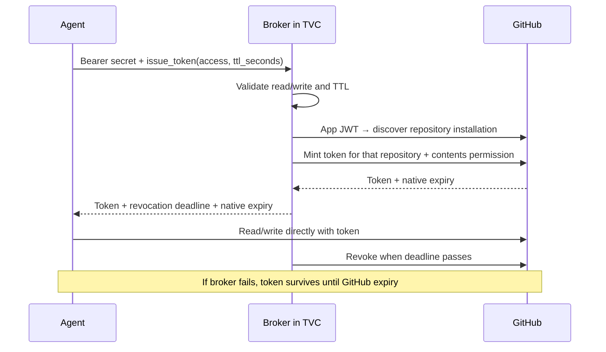
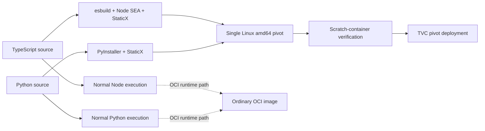
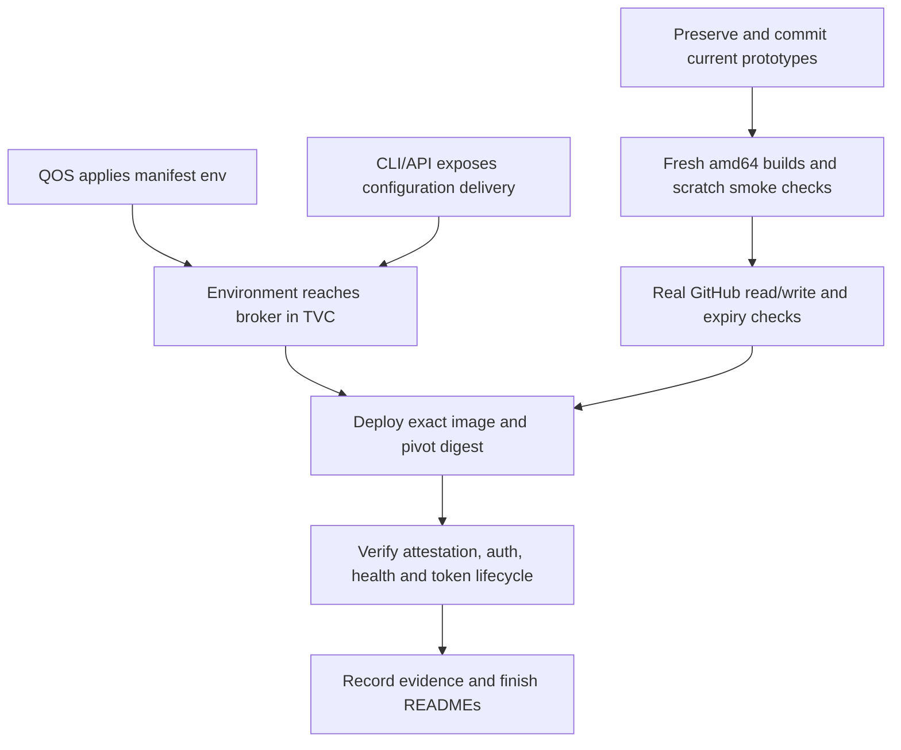

# Python / TypeScript TVC examples — handoff

Reviewed **2026-10-22** on `richard/py-ts-examples`. Goal: show teams can run useful
Python and TypeScript applications on TVC with ordinary application code.

**Both prototypes exist. Local tests pass. Live GitHub and TVC validation remain.**
The example directories are currently **untracked**; preserve them when handing
off. A branch push alone will not include these files until they are committed.

## What we are building

Two equivalent MCP servers that lend an agent temporary access to one GitHub
repository. GitHub App credentials stay in the broker; the agent gets a scoped
installation token. All holders of the demo bearer secret can request read/write
access. OAuth and Rego are extension points, not implemented features.

| Contract | Current implementation |
|---|---|
| Protocol | Official MCP SDKs v2.0.0; clients pin `2026-07-28`; Streamable HTTP `/mcp` |
| Authority | One configured `owner/repo`; `contents: read` or `write`, plus metadata read |
| Credentials | Fresh token request per call; GitHub App chosen over PAT/deploy keys |
| TTL | Integer 1–3,600 seconds, default 900; deadline capped at native expiry |
| Configuration | `GITHUB_APP_ID`, `GITHUB_REPOSITORY`, `GITHUB_PRIVATE_KEY`, `BROKER_TOKEN` |
| Networking | `HOST`, `PORT`, `PUBLIC_HOST`; public `/health`; bearer-protected `/mcp`; outbound GitHub HTTPS |

Installation ID is discovered from the repository, so no installation-ID setting
is needed. Create an App with Contents read/write, disable webhooks, install only
on the demo repository. Setup and runnable commands are in the example READMEs.

## Code and packaging

| Area | TypeScript | Python |
|---|---|---|
| Issuance / leases | [src/broker.ts](tvc-github-broker-ts/src/broker.ts) | [broker.py](tvc-github-broker-python/broker.py) |
| MCP / auth / lifecycle | [src/server.ts](tvc-github-broker-ts/src/server.ts) | [server.py](tvc-github-broker-python/server.py) |
| Setup / client / tests | [README](tvc-github-broker-ts/README.md) | [README](tvc-github-broker-python/README.md) |
| Binary build | [packaging](tvc-github-broker-ts/packaging/README.md) | [packaging](tvc-github-broker-python/packaging/README.md) |

Keep packaging separate from application logic. Node 24+ and Python 3.13+ are the
declared requirements. Both exported pivots need writable, executable temporary
storage and `/proc`; extracting the binary does not preserve Docker `ENV` or
the image's `/tmp` directory. Builds are not guaranteed bit-identical.

## Where things stand

| Check | Result from this review |
|---|---|
| TypeScript | `npm run check`, `npm test` (3 tests), `npm run bundle` pass |
| Python | `.venv/bin/python -m pytest -q` (7 tests), `pip check` pass |
| Test scope | Real MCP HTTP clients; mocked GitHub; scope/JWT/TTL/retry/shutdown checks |
| Existing binaries | Both `dist/pivot` files identify as statically linked Linux x86-64 ELF |
| Fresh scratch build/run | Outstanding: Docker daemon was not running; old binaries do not establish current build provenance |
| Real GitHub issuance/revocation | Outstanding; requires a disposable App/repository |
| TVC deployment | Outstanding; environment delivery remains blocked |

Local verification used Node 26.12.0 and Python 3.14.8; Docker builds target Node
24 and Python 3.13. Verify those build runtimes when Docker is available.

## Remaining work

1. **Verify packaging:** rebuild both images; run `--self-test`, then authenticated
   MCP discovery and issuance against the packaged servers. The self-test checks
   DNS/TLS/imports only. Check `/tmp`, `/proc`, startup, and shutdown on QOS too.
2. **Exercise GitHub:** prove read cannot write, write can write, another repository
   is inaccessible, and tokens stop working after successful revocation. Confirm
   a fresh grant works; keep credentials out of logs and committed artifacts.
3. **Resolve TVC configuration:** [QOS #806](https://github.com/tkhq/qos/pull/806)
   remains open. Current [QOS launch code](https://github.com/tkhq/qos/blob/f90be65db26e9080b2a5cb806612d62f525fa415/src/qos_core/src/reaper.rs#L246)
   clears the environment; current [CLI deployment config](https://github.com/tkhq/rust-sdk/blob/ba31b038f6c5302d35d58597135cc235c2d1300b/tvc/src/config/deploy.rs#L29)
   has no environment field. Both delivery steps need a supported path.
4. **Deploy and document evidence:** use the published image's Linux amd64 platform
   digest and SHA-256 of `/pivot` extracted from that image, port 3000 for ingress
   and HTTP health, the actual app public hostname, and GitHub egress. Record the
   QOS release and successful end-to-end checks before describing TVC as working.

The current [manifest environment value](https://github.com/tkhq/qos/blob/f90be65db26e9080b2a5cb806612d62f525fa415/src/qos_core/src/protocol/services/boot/env.rs#L213)
supports plaintext only. Use disposable demo credentials for that path; production
secret provisioning is separate work.

## Lease behavior to keep explicit

Each process keeps its own leases in memory, with no application admission cap.
One sequential cleanup loop waits one second between passes. GitHub calls use a
10-second timeout (Node request deadline; Python HTTP phase timeouts). Slow calls
delay other revocations; failures retry on later passes. Shutdown makes one final
pass. No durable queue survives a crash, and replicas cannot clean each other's
leases. GitHub's native one-hour expiry is the fallback.

Review limits, timeouts, retries, and shutdown behavior with Richard before changing
them. Durable cleanup, OAuth, and richer policy remain production extensions.

Origin: approved September 18/22 plans in Surreal (`fact:5ryw5wytfij15rr7euxd`
→ `fact:bzgk8doc3bz3n986aq7e`), reconciled against this working tree.
