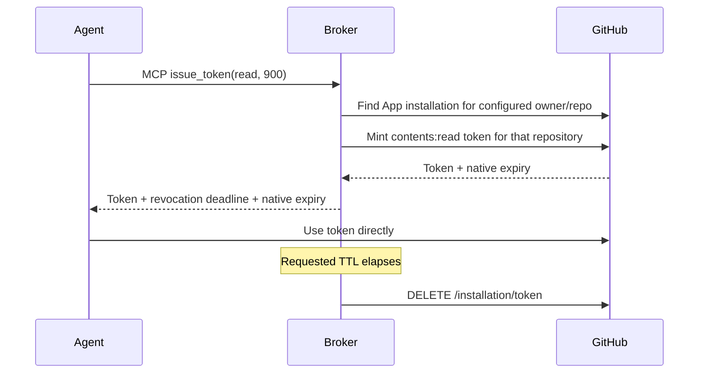

# GitHub credential broker · Python

A small MCP server that gives an agent temporary access to **one GitHub
repository**. It uses the official MCP Python SDK v2 and the `2026-07-28`
protocol. The [TypeScript example](../tvc-github-broker-ts) implements the same flow.

**Status (2026-10-22):** all seven tests and the installed dependency check pass
locally. GitHub is mocked in tests. Scratch-container execution and live
GitHub/TVC deployment remain unverified in this review; TVC environment delivery
is blocked as described below.

An agent calls `issue_token(access, ttl_seconds)`. The broker authenticates as a
GitHub App, mints a fresh installation token with `contents: read` or
`contents: write`, and revokes it through GitHub when its lease ends. The App's
private key stays in the broker. Tokens work with GitHub's contents API and Git
over HTTPS; `write` also permits reading. This example does not grant issues,
pull-request, administration, or Actions API permissions.



## Create a GitHub App

1. Open [GitHub App settings](https://github.com/settings/apps/new). Choose a name
   and a homepage URL. Disable the webhook; this example needs no callback URL,
   OAuth user flow, client secret, or event subscriptions.
2. Grant **Repository permissions → Contents → Read and write**. Metadata read
   access is included automatically. Leave other permissions unset.
3. Create the App, note its **App ID**, and generate/download a private key.
4. Install it on your account or organization, selecting **only the demo repo**.

A personal access token cannot mint narrower tokens; a GitHub App can.
The broker discovers its installation ID from `owner/repo`, so you do not need
to configure that ID separately. See GitHub's
[installation token API](https://docs.github.com/en/rest/apps/apps#create-an-installation-access-token-for-an-app).

## Run locally

Requires Python 3.13+.

```sh
python3 -m venv .venv
.venv/bin/pip install -r requirements.lock
export GITHUB_APP_ID=123456
export GITHUB_REPOSITORY=your-owner/your-demo-repo
export GITHUB_PRIVATE_KEY="$(cat /path/to/downloaded-private-key.pem)"
export BROKER_TOKEN="$(openssl rand -hex 32)"
.venv/bin/python server.py
```

The server reads environment variables. `.env.example` lists them; it is not
automatically loaded. Literal `\n` sequences in the PEM are also accepted.
Defaults are `HOST=127.0.0.1`, `PORT=3000`, and `PUBLIC_HOST=localhost`.
Set `PUBLIC_HOST` to the broker's public hostname when deploying behind HTTPS.

`GET /health` is public. `/mcp` requires `Authorization: Bearer <BROKER_TOKEN>`.
Share this demo bearer secret with the client, never the GitHub App private key.
All holders have the same authority. The authentication and policy comments in
the code show where OAuth and Rego would fit.

## Request and use a token

In another shell with the same `BROKER_TOKEN`:

```sh
# The client requires the 2026-07-28 protocol; it does not fall back to v1.
umask 077
.venv/bin/python client.py read 60 > grant.json
# For read/write access instead: .venv/bin/python client.py write 900 > grant.json
```

Set `MCP_URL=https://your-broker.example/mcp` for a remote server. Any compatible
Streamable HTTP MCP client can call the same tool:

```json
{"name":"issue_token","arguments":{"access":"read","ttl_seconds":60}}
```

The result contains `token`, `repository`, `access`, `expires_at` (broker
revocation deadline), and `github_expires_at` (GitHub-enforced expiry).
For example, use the issued token with GitHub CLI without embedding it in a Git URL:

```sh
GH_TOKEN="$(jq -r .token grant.json)" gh api "repos/$GITHUB_REPOSITORY/contents"
```

Repeat after the requested TTL plus a cleanup tick: GitHub should reject it.
Call `issue_token` again for a fresh token. The client deliberately writes a
credential to stdout; keep `grant.json` private and remove it after the demo.

## TTL behavior

- TTL is an integer from **1 to 3,600 seconds**, default **900**. Each request
  creates a new token; the broker never returns a cached or renewed token.
- One cleanup loop waits one second between passes and revokes tokens sequentially.
  Slow requests and rate limits can delay later tokens; failed revocations remain
  queued for subsequent passes. Shutdown makes one final pass over outstanding
  tokens; failures are not retried after exit.
- GitHub installation tokens expire natively after **one hour**. Shorter TTLs are
  broker-enforced leases, not a GitHub expiry setting. If the process crashes or
  cannot reach GitHub, a token can remain usable until `github_expires_at`.
- Leases live in memory. Each replica must stay running to revoke its own leases.
  A production system would persist the revocation queue and monitor failures.

## Build a TVC pivot

```sh
docker build --platform linux/amd64 -t tvc-github-broker-python:local .
docker run --rm --platform linux/amd64 tvc-github-broker-python:local --self-test
docker build --platform linux/amd64 --target binary --output type=local,dest=dist .
shasum -a 256 dist/pivot
```

`dist/pivot` is one Linux AMD64 executable containing CPython, the application,
and required system libraries. The final image contains that executable and an
empty `/tmp` directory. It needs no external Python installation, shell, or pip
packages. It unpacks into writable executable temporary storage at startup.

To run the packaged server with your environment:

```sh
docker run --rm --platform linux/amd64 -p 127.0.0.1:3000:3000 \
  -e GITHUB_APP_ID -e GITHUB_REPOSITORY -e GITHUB_PRIVATE_KEY -e BROKER_TOKEN \
  tvc-github-broker-python:local
```

For TVC, publish the image to your registry and use `/pivot` as `pivotPath`, its
SHA-256 as `expectedPivotDigest`, and port **3000** for ingress and the HTTP
health check. The broker needs outbound DNS and HTTPS to `api.github.com`.
Follow the existing
[TVC deployment flow](https://docs.turnkey.com/features/verifiable-cloud/quickstart)
once the environment dependency below is resolved. Pin the published image's
Linux AMD64 platform digest, and hash the `/pivot` extracted from that exact image.
Rebuilding for export can produce a different executable.

Runtime configuration belongs in the QOS v2 manifest's `pivot.env`. Each entry
uses `{"plain":{"value":"..."}}`, for example this fragment for non-secret settings:

```json
{
  "pivot": {
    "env": {
      "GITHUB_APP_ID": {"plain": {"value": "123456"}},
      "GITHUB_REPOSITORY": {"plain": {"value": "your-owner/your-demo-repo"}},
      "HOST": {"plain": {"value": "0.0.0.0"}},
      "PORT": {"plain": {"value": "3000"}},
      "PUBLIC_HOST": {"plain": {"value": "<publicDomain from tvc app list>"}}
    }
  }
}
```

This is a manifest fragment, not a `tvc deploy create` config. Read the actual
`publicDomain` from `tvc app list --message-format json`; do not construct it from
an app ID. Docker `ENV` settings do not travel with the extracted executable.

**TVC deployment dependency (checked 2026-10-22):** the manifest schema supports
`pivot.env`, but the
[QOS pivot launch code](https://github.com/tkhq/qos/blob/f90be65db26e9080b2a5cb806612d62f525fa415/src/qos_core/src/reaper.rs#L246)
still clears the environment without applying those entries.
[QOS PR #806](https://github.com/tkhq/qos/pull/806) addresses injection and remains
open. The current
[TVC CLI deployment config](https://github.com/tkhq/rust-sdk/blob/ba31b038f6c5302d35d58597135cc235c2d1300b/tvc/src/config/deploy.rs#L29)
also has no environment input. Resolve both delivery steps before deploying;
merging the QOS fix alone is insufficient. Verify the selected QOS release also
provides writable, executable temporary storage and `/proc` for StaticX.

The broker also requires `GITHUB_PRIVATE_KEY` and `BROKER_TOKEN`. The current
[manifest value type](https://github.com/tkhq/qos/blob/f90be65db26e9080b2a5cb806612d62f525fa415/src/qos_core/src/protocol/services/boot/env.rs#L213)
supports only plaintext values, not encrypted secrets. For disposable demo
credentials, use the same entry shape once environment injection is available;
JSON-escape PEM newlines as `\n`. Anyone with access to the manifest can read these
credentials. A production deployment would use encrypted secret provisioning.

The application has no packaging-specific branches. With full OCI support, run
`python server.py` in a normal Python container with the same environment and omit
`packaging/` entirely. See [packaging notes](packaging/README.md).

## Code and tests

- [`broker.py`](broker.py): GitHub App authentication, issuance, lease cleanup.
- [`server.py`](server.py): official MCP server, demo auth, configuration, lifecycle.

```sh
.venv/bin/python -m pytest -q
```

Tests verify JWT signatures, repository/permission restriction, fresh tokens,
TTL bounds, failed-revocation retries, shutdown cleanup, and real MCP HTTP calls
using the `2026-07-28` protocol. GitHub is mocked; tests do not mutate a repository.
