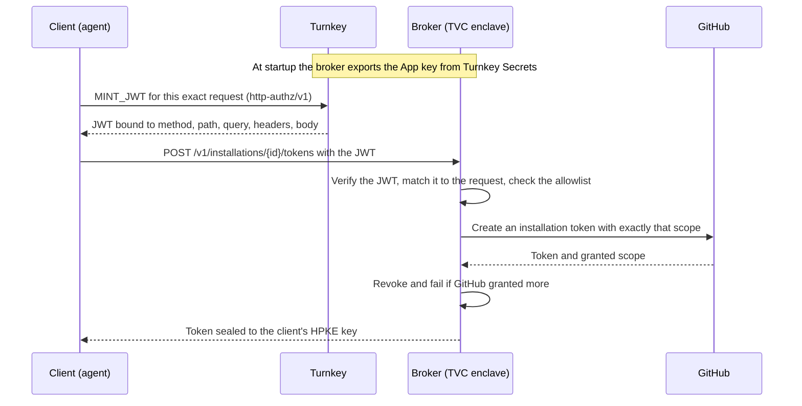

# Architecture

## Request flow

1. The GitHub App key is stored in Turnkey Secrets. At startup the broker exports it with `EXPORT_SECRETS`, decrypts it in process, and never writes it to disk.
2. A client asks Turnkey for a JWT for `POST /v1/installations/{id}/tokens?permissions=...&repositories=...`. The JWT binds the method, path, query, the `accept` and `x-github-api-version` headers, and the body, which carries the client's HPKE public key.
3. The client calls the broker with the JWT. The broker verifies the token, checks that it describes this exact request, and checks the scope against its allowlist.
4. The broker signs a short-lived GitHub App JWT and asks GitHub for a token with exactly the requested scope. If GitHub grants more, the broker revokes the token and fails.
5. The broker seals the token to the client's HPKE key. Only the original caller can read it.

## Keys in an enclave

QOS gives the app two seeds. The broker derives from them and needs no key file:

| Seed | File | What the broker derives | Why |
| --- | --- | --- | --- |
| Quorum | `/qos.quorum.key` | The Turnkey API key (HKDF-SHA512, salt `tvc-github-broker-export-v1`) | The quorum key is the same on every deployment, so the key is registered with Turnkey once. Only code that holds the quorum key can stamp with it. |
| Ephemeral | `/qos.ephemeral.key` | The export target, the QOS encrypt key (HKDF-SHA512, salt `qos_p256_encrypt`) | A new one is used on every boot, and QOS attests its public half in the Boot Proof. A secret encrypted to it can only be read inside that enclave. |

Outside an enclave there are no seed files. The broker then reads an API key file (`--turnkey-api-key-path`) and uses a random export target. This is for local runs only, and it logs a warning.

`--bootstrap` starts the broker with no config. It serves only `/health` and `/v1/api-public-key`, so you can read the derived API public key and register it with Turnkey before the real deployment.

## Configuration

The broker reads one JSON file (`--config`), or the same JSON as an argument (`--config-json`) when the image has no config file. [`deploy/broker-config.example.json`](deploy/broker-config.example.json) is a complete example.

| Field | Meaning |
| --- | --- |
| `audience` | The broker's exact origin. Must equal the JWT `aud` and the audience you mint for. |
| `organization_id` | The top-level organization that the JWT `iss` must name. |
| `trusted_jwks` or `trusted_jwks_path` | The pinned JWK Set of the `MINT_JWT` signing key. Give exactly one. Each key's `kid` must be its RFC 7638 thumbprint. |
| `github.app_client_id` | The GitHub App's client ID, used as the App JWT `iss`. |
| `github.expected_key_sha256` | Optional. The exported key must have this `SHA256:` fingerprint. |
| `turnkey.api_base_url`, `turnkey.organization_id`, `turnkey.secret_id` | Where the App key is stored. |
| `turnkey.signer_public_key` | The pinned Signer enclave key. The admin `probe` command prints it as `enclaveQuorumPublic`. |
| `installations` | Installation ID to allowlist entry: `repositories` (lowercase), `permissions` with the highest level, and optionally `organizations` (the JWT `org` claim) allowed to use it. |
| `detailed_auth_errors` | Put the failed check in the body of a rejected request. For debugging only. |

## Security notes

- The App key is never logged or written to disk, and is zeroized after use. RSA signing uses `ring`, not the `rsa` crate (RUSTSEC-2023-0071).
- Tokens are not single-use. A replayed JWT yields a new token for the same exact request until `exp`. The new token is sealed to the original caller's key.
- Policy can match the exact query string, but it cannot express a subset of repositories. The broker's allowlist therefore limits repositories and permissions. Repository names must be lowercase, because GitHub matches names without case.
- Turnkey does not check that an export target is the enclave's ephemeral key. What protects the App key is that only the quorum key can stamp the export, and the export policy covers one user and one key, matched by the fingerprint that `import-app-key` prints. Whoever holds the quorum key shares can derive the API key.
- The bootstrap response is not authenticated. A host or ingress that replaces `/v1/api-public-key` with its own key would get the export permission when you register it. Before you register the key, check it against a source you trust: run `--print-api-public-key` from the same image and compare, or check the deployment's Boot Proof. The example does not return a signed assertion.
- Outside an enclave the API key is a file. Treat it as sensitive as the App key.
- The broker serves plain HTTP and connects directly to GitHub and Turnkey. TLS termination and egress routing decide who can see the JWT. HPKE delivery protects the token either way.

## Layout

- `src/github-broker`: the broker (axum). `src/tvc-secrets`: the Turnkey Secrets export client.
- `admin/`: setup commands for a Turnkey organization (`bun admin/src/cli.ts`). `client/` and `scripts/`: the demo.
- `lib/`: TypeScript digest, header, query, and HPKE helpers shared by the client and admin tools. `testdata/digests.json` holds vectors that the Rust side runs too.
- `images/`: the StageX container build.

## Tests

`make -C src test` runs the Rust tests, and `bun test tests/` runs the shared digest, header, and query vectors. The end-to-end path needs real Turnkey and GitHub, so the demo is the check.
