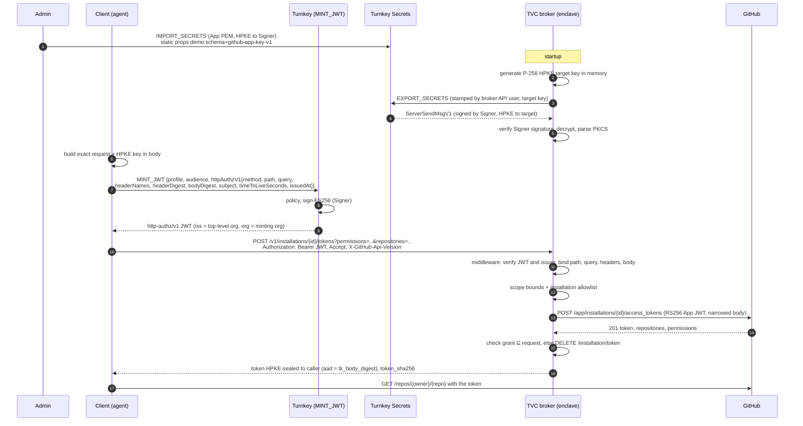

# tvc-github-broker

A Turnkey Verifiable Cloud (TVC) app that works as a GitHub App token broker.
An agent gets a GitHub installation token that is narrowed to named
repositories and permissions. The agent never holds the GitHub App private
key, and Turnkey organization policy decides which scopes each principal can
get.

The broker accepts a request only with a request-bound authorization JWT from
the http-authz/v1 profile (`JWT_PROFILE_HTTP_AUTHZ_V1`) of
`ACTIVITY_TYPE_MINT_JWT`. A Turnkey user asks Turnkey to mint a token for one
exact HTTP request, and the broker verifies it with the
[`turnkey_jwt_profiles`](https://github.com/tkhq/rust-sdk/tree/main/jwt_profiles)
crate. This repository also includes a local stand-in for Turnkey (`shim/`) so
the tests and the offline demo run without a Turnkey organization.

## What the demo shows

1. The GitHub App private key is stored in Turnkey Secret Storage. At startup
   the broker exports it with `EXPORT_SECRETS` to an HPKE key that it
   generates in memory, decrypts it in process, and never writes it to disk.
2. A client asks Turnkey (or the local stand-in) for an http-authz/v1 JWT for one exact
   HTTP request:
   `POST /v1/installations/{id}/tokens?permissions=...&repositories=...`,
   with the `accept` and `x-github-api-version` headers and the body bound.
   Policy sees the method, the path, the query string, the bound header
   names, and the subject. It decides who may call which installation. The
   broker's allowlist decides which repositories and permissions.
3. The broker's verifier middleware checks the JWT strictly, checks that the
   token names the broker's configured top-level organization, and checks that
   it describes the request it received, including the bound headers. The token works until it expires (the client asks for 60 s; the
   profile allows up to 300 s). Tokens are not single-use.
4. The broker signs an RS256 App JWT with `ring` and asks GitHub for a token
   with exactly the requested `repositories` and `permissions`. It checks
   GitHub's answer. If GitHub granted more, the broker revokes the token and
   fails.
5. The broker encrypts the token to the caller's HPKE key. The caller
   decrypts it and makes one narrowed GitHub API call.
6. A path or user outside policy fails at Turnkey. A scope outside the
   allowlist fails at the broker. An altered request (query, body, or a bound
   header) fails at the broker. A replay before `exp` gets a new token,
   sealed to the original caller's key.

## Architecture



## Real parts and the local stand-in

| Part | In this repo | Real target |
| --- | --- | --- |
| `MINT_JWT` activity, http-authz/v1 profile | **Local stand-in** (`shim/`): one bun process plays the coordinator, policy engine, and Signer. Its ES256 key is a local file. It validates the `MintJwtIntent` (digest format, header name rules, TTL 1 to 300 s, `issuedAt` within 24 hours, subject is a user of the org) and builds the same claims Turnkey does: `iss` names the top-level organization and `org` the minting one. | Turnkey: the `MINT_JWT` activity, with the Signer quorum key. |
| Policy | **Local stand-in** (`shim/src/policy.ts`): JSON conditions in the shape of Turnkey policies. The field names are illustrative; see [Policies](#policies). The `http.query[...]` subset matchers are a **future** extension, kept for tests. | Turnkey policy engine. |
| http-authz/v1 verifier | **Real** code: the [`turnkey_jwt_profiles`](https://github.com/tkhq/rust-sdk/tree/main/jwt_profiles) crate from the Turnkey Rust SDK, with its Axum layer. Token checks, issuer check, request binding, and pinned keys. | Same. |
| Header binding (`headerNames`, `headerDigest`) | **Real** code: the client computes one digest per header (`lib/headers.ts`), and the verifier rebuilds each value from what hyper delivers. Shared vectors in `testdata/digests.json`. | Same client and verifier rules. |
| Scope enforcement | **Real**: the broker's per-installation allowlist (`installations` in the config). Policy cannot assert on query parameters. | Same, until a policy extension can parse the query. |
| Replay | Tokens are not single-use. A token works until `exp`. | Same. |
| Signer key | Pinned JWK Set file (`trusted_jwks_path`) through `PinnedKeySet`. | The MINT_JWT signing key of your Turnkey deployment. |
| Secrets export client | **Real** code, as the workspace crate `src/tvc-secrets/` (`tvc-secrets`): stamping, `EXPORT_SECRETS`, activity polling, Signer-signature verification against a pinned key, in-process decryption, zeroization. | Same. |
| Secrets API (`INIT_IMPORT_SECRETS`, `IMPORT_SECRETS`, `EXPORT_SECRETS`) | **Real** with `--live-secrets`. The stand-in implements the same wire shapes for offline tests. | Same. |
| Enclave-encrypt decrypt in the broker | **Real**: Turnkey's `turnkey_enclave_encrypt` crate, inside `tvc-secrets`. | Same. |
| Stamps | **Real** format (`X-Stamp`, `SIGNATURE_SCHEME_TK_API_P256`). The client uses `@turnkey/api-key-stamper`; `tvc-secrets` stamps in Rust. | Same. |
| Broker (scope checks, GitHub client, delivery) | **Real** code, run as a normal process. | Same binary in a TVC enclave. |
| GitHub | Mock (`tests/mock-github.ts`) or the real API (`bun run demo:github`). | Real API. |

## Layout

```
src/                       Rust workspace (toolchain 1.88)
  tvc-secrets/             crate: Turnkey Secrets export client (README inside)
    src/lib.rs             SecretsClient, SecretsConfig, SecretsError, SignerPublicKey
    src/stamp.rs           P-256 API key and X-Stamp
    src/secret.rs          SecretBytes and SecretString (zeroize on drop)
  github-broker/           the TVC app, on top of `tvc-secrets` and `turnkey_jwt_profiles`
    src/scope.rs           scope parsing, bounds, app allowlist
    src/query.rs           the broker's canonical query form
    testdata/              scope query vectors (shared with lib/canonical.ts)
    src/appkey.rs          PKCS#1 PEM -> ring RSA key, fingerprint, RS256
    src/github.rs          token request, grant checks, revocation
    src/delivery.rs        HPKE token delivery
    src/router.rs          HTTP surface
  metrics/                 Prometheus middleware (from the template)
images/github-broker/      StageX Containerfile
testdata/                  digest and header vectors (shared with the Rust SDK crate)
lib/                       shared TS: digests, header binding, broker scope query, HPKE, P-256, encoding
shim/                      local Turnkey stand-in (MINT_JWT + Secrets)
client/                    demo client
admin/                     admin tool: import the App key, create the broker user and policy
tests/                     bun tests: unit, e2e, mock GitHub, harness
scripts/                   demo-local.ts, demo-github.ts
```

## Run locally with the mock

Requirements: Rust 1.88 (installed by `rust-toolchain.toml`), bun 1.4 or later.

```sh
bun install
make test          # clippy, Rust unit tests, typecheck, bun unit + e2e tests
bun run demo:local # local Turnkey stand-in + mock GitHub + broker + demo client
```

`demo:local` generates a throwaway RSA-2048 key, imports it into the stand-in
through the SDK's `importSecret`, starts the broker (which exports it), and
runs the client. It prints one PASS or FAIL line per check.

## Build the OCI image

The image uses [StageX](https://stagex.tools). It needs
Docker 26 or later with the containerd image store.

```sh
make out/github-broker/index.json
```

The build prints `SHA256=<digest>` for `/tvc_app`, which TVC needs for the
deployment. `ring` (with its C and assembly parts) builds in the StageX Rust
pallet with `--network=none`.

## Run with live Turnkey Secrets

This stores the App key in real Turnkey Secret Storage. In this script the
JWT still comes from the local stand-in; the client's `mintJwt` sends the same
`MINT_JWT` request to Turnkey when you point it at an organization whose
policy allows it. The admin key is read only by the admin process.

```sh
export TURNKEY_API_BASE_URL=https://api.turnkey.com
export TURNKEY_ORGANIZATION_ID=<org id>
export TURNKEY_API_KEY_FILE=<admin or root API key file>
# Read the Signer public key of your deployment once, unless it is the SDK's
# pinned production key:
bun admin/src/cli.ts probe      # prints enclaveQuorumPublic
export TURNKEY_SIGNER_PUBLIC_KEY=<that value>

# 1. A dedicated API user for the broker. Writes the key file (0600).
bun admin/src/cli.ts --live-secrets create-broker-user --out .demo/live/broker-api-key.json
# 2. The ALLOW policy for EXPORT_SECRETS (see "Policies" below).
bun admin/src/cli.ts --live-secrets create-export-policy --broker-user-id <userId from step 1>
# 3. The App key. For a dry run, make a throwaway key first:
bun admin/src/cli.ts gen-test-key --out .demo/live/throwaway-app-key.pem
bun admin/src/cli.ts --live-secrets import-app-key --pem .demo/live/throwaway-app-key.pem --app-client-id Iv23liMockDemo
rm .demo/live/throwaway-app-key.pem

# 4. Run the demo; the broker exports the key from Turnkey at startup.
TURNKEY_ORGANIZATION_ID=... LIVE_SECRET_ID=<secretId> TURNKEY_SIGNER_PUBLIC_KEY=... \
LIVE_BROKER_API_KEY=.demo/live/broker-api-key.json \
APP_PUBLIC_KEY_PEM=.demo/live/throwaway-app-key.pem.pub LIVE_KEY_SHA256=<fingerprint> \
bun scripts/demo-local.ts --live-secrets
```

To clean up, delete the policy, the broker user, and the secret in the
dashboard or with the SDK (`deletePolicy`, `deleteUsers`, `deleteSecrets`).

## Run live against a real GitHub App

Use a throwaway GitHub account or organization. Do not use a production App.

1. **Create the App.** Settings → Developer settings → GitHub Apps → New
   GitHub App. Set any homepage URL. Clear **Webhook → Active**. Under
   **Repository permissions** set **Contents: Read-only** (Metadata:
   Read-only is set automatically). Leave every other permission at No
   access. Set **Where can this GitHub App be installed?** to **Only on this
   account**. Create it, and note the **Client ID** (`Iv23li...`).
2. **Install it on one test repository.** On the App page, choose **Install
   App** → your account → **Only select repositories** → pick one test
   repository. After install, the URL is
   `https://github.com/settings/installations/<installation id>` (or
   `/organizations/<org>/settings/installations/<id>`). Note the ID.
3. **Download the key.** On the App page, **Private keys → Generate a private
   key**. GitHub downloads a PKCS#1 `.pem`. Note the SHA256 fingerprint that
   GitHub shows.
4. **Run the demo.** The repository name must be lowercase.

   ```sh
   GITHUB_APP_CLIENT_ID=Iv23li... \
   GITHUB_INSTALLATION_ID=<installation id> \
   GITHUB_OWNER=<account or org login> \
   GITHUB_REPO=<test repo> \
   GITHUB_APP_PEM=~/Downloads/<app>.<date>.private-key.pem \
   bun run demo:github
   ```

   The script imports the PEM into the local stand-in's Secrets API, starts the
   broker against `https://api.github.com`, and runs the client. The client
   calls `GET /repos/{owner}/{repo}` with the narrowed token, then revokes the
   token. Compare the printed fingerprint with the one from step 3.

   To use real Turnkey Secret Storage instead, import the PEM with
   `admin import-app-key --live-secrets` (see above), delete the PEM, and run
   `bun scripts/demo-github.ts --live-secrets` with `TURNKEY_ORGANIZATION_ID`,
   `LIVE_SECRET_ID`, `TURNKEY_SIGNER_PUBLIC_KEY`, `LIVE_BROKER_API_KEY`, and
   `LIVE_KEY_SHA256` set.

5. **Clean up.** Delete the private key in the App settings, or delete the
   App.

## Broker API

```
POST /v1/installations/{installation_id}/tokens?permissions=<name>%3A<level>&...&repositories=<name>&...
Authorization: Bearer <http-authz/v1 JWT>
Accept: application/vnd.github+json
X-GitHub-Api-Version: 2022-11-28
Content-Type: application/json

{"hpke_public_key":"<base64url SEC1 uncompressed P-256 point>"}
```

Each permission and each repository is its own query parameter (repeated
keys). A comma has no special meaning: it is encoded as `%2C`, and the broker
refuses it in a name. The http-authz/v1 profile compares the raw query byte
for byte. The broker also requires its own canonical query form
("Broker query form" below), so pairs are sorted by key, then by value. On top of that the broker requires only the
keys `permissions` and `repositories`, each at least once; repository names
lowercase and unique; and one level per permission name. So each scope has
exactly one query string. Example:

```
/v1/installations/12345/tokens?permissions=contents%3Aread&permissions=pull_requests%3Awrite&repositories=backend&repositories=frontend
```

The token must bind the `accept` and `x-github-api-version` headers
(`tk_request.headers` must contain both, in any order). It can bind more. The
client sends each bound header once.

`201` response:

```json
{
  "installation_id": 12345,
  "repositories": ["demo"],
  "permissions": {"contents": "read", "metadata": "read"},
  "repository_selection": "selected",
  "expires_at": "2026-09-24T04:05:20Z",
  "token_sha256": "<base64 SHA-256 of the token>",
  "encrypted_token": {"suite": "DHKEM(P-256, HKDF-SHA256), HKDF-SHA256, AES-256-GCM", "encapsulated_key": "...", "ciphertext": "...", "aad": "tk_body_digest"},
  "authorization": {"iss": "https://id.turnkey.com/t/<uuid>", "org": "urn:turnkey:org:<uuid>", "sub": "urn:turnkey:user:<uuid>", "iat": 1790000000, "exp": 1790000060}
}
```

Errors are `{"error": "<code>", "message": "..."}`: `401` for every
authorization failure (`wrong_aud`, `wrong_typ`, `unknown_kid`, `expired`,
`wrong_iss`, `request_mismatch`,
`header_binding_required`, ...), `413 body_too_large`, `400 invalid_scope` or `invalid_body`,
`403 scope_not_allowed` (app allowlist), `502 github_error` or
`github_grant_too_broad`.

`GET /v1/info` returns the audience, the issuer, the trusted
`kid` values, the App client ID, the App key fingerprint, and the token
route's required headers. `GET /health` and `GET /metrics` are from the
template.

### Token delivery

HPKE delivery is **required**. The body digest is inside the JWT, so no one
between the client and the broker can swap the key. The broker seals the
token inside the enclave, so the TVC host and any TLS terminator in front of
the enclave see only ciphertext. The AAD is the JWT's `tk_body_digest` (the
client knows it already), which binds the ciphertext to the request body that
carries the HPKE key. The suite matches Turnkey's enclave-encrypt
transport; the `info` string is different.

## Verification rules

The verifier is the Axum layer of the
[`turnkey_jwt_profiles`](https://github.com/tkhq/rust-sdk/tree/main/jwt_profiles)
crate (`http_authz::middleware`) on the token route, with a per-route rule:
required bound headers and a required body digest. The crate's documentation
has the full list of checks. In short:

1. Exactly one `Authorization: Bearer <jwt>`, a compact JWS in strict
   unpadded base64url.
2. The protected header has exactly `alg`, `kid`, and `typ`. `alg` is `ES256`
   and `typ` is `application/vnd.turnkey.http-authz-v1+jwt`. `kid` selects a
   key from the pinned JWK Set, and each key's `kid` must be its RFC 7638
   thumbprint.
3. The signature is checked before any claim is read.
4. The claim set is closed: `iss` (`https://id.turnkey.com/t/<uuid>`, the
   top-level organization), `org` (`urn:turnkey:org:<uuid>`, the organization
   that minted the token), `sub` (`urn:turnkey:user:<uuid>`), `aud`, `iat`,
   `exp`, `tk_request {method, path, query, headers?}`, `tk_header_digest?`,
   and `tk_body_digest?`. Unknown claims, nulls, and wrong types are
   rejected. There is no `jti`.
5. `iss` names the configured top-level organization (`organization_id`).
   `org` is that organization or one of its sub-organizations.
6. Each bound header digest matches the received headers, and the handler
   sees the bound header as one normalized value. `authorization` can never be
   bound.
7. `tk_body_digest` is required on this route and matches the body bytes.
8. Method, path, and raw query equal the descriptor byte for byte. Every
   header the route requires must be in `tk_request.headers`.
9. `now < exp`, `iat <= now + skew` (skew default 5 s, at most 30 s),
   `exp > iat`, and `exp - iat <= 300`.
10. `aud` equals the configured origin byte for byte.

A rejected request gets a generic `401`. Set `detailed_auth_errors` in the
config to see which check failed; the tests do, and you should not in
production.

The handler then gets `iss`, `org`, and `sub`, and runs the scope bounds, the
app allowlist (which can limit an installation to some organizations), and the
GitHub call.

### Replay

Tokens are not single-use. Nothing is stored, so every replica and restart
agree. A holder can repeat the exact approved request until `exp`. For this
broker, a replay makes GitHub issue another installation token, but the body
binds the caller's HPKE key, so only the original caller can decrypt it. The
cost is extra tokens (GitHub rate limits and audit noise), and a client can
retry a failed call with the same JWT.

### Digests and header binding

Both sides run the shared vectors in `testdata/digests.json`.

- A digest is exactly one RFC 9530 member, `sha-256=:<base64>:`, with
  standard padded base64 (44 characters). No other algorithm, no parameters,
  no whitespace, no second member. The body digest equals a valid
  `Content-Digest` value for the body bytes as received.
- `headerNames` is 0 to 32 lowercase HTTP token names, unique, in any order.
  `authorization`, `proxy-authorization`, `host`, `connection`, `keep-alive`,
  `proxy-connection`, `te`, `trailer`, `transfer-encoding`, `upgrade`, and
  pseudo-headers (`:...`) are refused.
- For each bound name, the field lines for that name in received order, each
  trimmed of leading and trailing spaces and tabs, are joined with `", "` and
  hashed. A bound header that is absent fails. A value with a byte outside
  visible ASCII, space, and tab fails. hyper delivers lowercase names and
  keeps repeated fields in order, so the broker rebuilds each value directly
  from its `HeaderMap`.

### Broker query form

This is a rule of the broker, not of the profile. The broker accepts the token
route's query only in one canonical form, so each scope has one query string
and a policy that lists or denies exact query strings cannot be sidestepped by
reordering. `src/github-broker/src/query.rs` and `lib/canonical.ts` run the
shared vectors in `src/github-broker/testdata/scope-query.json`:

- Only RFC 3986 unreserved bytes appear literally. Every other byte is `%XX`
  with uppercase hex.
- Split on `&`, then on the first `=`. Percent-decode. `+` is a literal plus.
  Empty components and empty keys are errors. Sort by key bytes, then value
  bytes. Keep repeated keys as separate pairs. Commas have no special meaning
  (`%2C`). Re-encode.

## Policies

The local stand-in evaluates policy on `activity.params.profile`,
`activity.params.audience`, and `activity.params.httpAuthzV1.method`, `.path`,
`.query`, `.subject`, and `.headerNames`. It does not see digests or the TTL.
These field names describe the stand-in and are illustrative: they may differ
from what Turnkey exposes to its policy engine for `MINT_JWT`, and an
organization's root quorum can authorize a mint without any policy. A policy
can compare the query string exactly, but it cannot assert on query
parameters, such as "any subset of these repositories". So the split is:

| Control | Decides |
| --- | --- |
| Turnkey policy | Who can mint, for which audience, method, and path, and whether a query is present (or which exact query strings). |
| Broker allowlist (`installations` in the config) | Which repositories and permissions, as a subset of what each installation allows, and for which organizations. |

The stand-in's default policy (`bun shim/src/cli.ts init` writes it to
`.shim/policy.json`):

1. **ALLOW** alice to mint for installation 12345 when a query is present:

   ```text
   condition:
     activity.type == 'ACTIVITY_TYPE_MINT_JWT' &&
     activity.params.profile == 'JWT_PROFILE_HTTP_AUTHZ_V1' &&
     activity.params.audience == 'https://broker.example' &&
     activity.params.httpAuthzV1.method == 'POST' &&
     activity.params.httpAuthzV1.path == '/v1/installations/12345/tokens' &&
     activity.params.httpAuthzV1.query != ''
   consensus:
     approvers.any(user, user.id == '<alice user id>')
   ```

   With `--repos` and `--permissions` (as `demo:github` does), the last line
   is an exact list instead, one entry per allowed scope:

   ```text
     activity.params.httpAuthzV1.query in [
       'permissions=contents%3Aread&permissions=metadata%3Aread&repositories=demo'
     ]
   ```

2. **ALLOW** the broker's API user to export the App key:

   ```text
   condition:
     activity.type == 'ACTIVITY_TYPE_EXPORT_SECRETS' &&
     secret.static_properties['demo:schema'] == 'github-app-key-v1'
   consensus:
     approvers.any(user, user.id == '<broker user id>')
   ```

**Future extension, not in Turnkey policy today.** `shim/src/policy.ts` also
evaluates `http.query['<param>']`: the list of values of a repeated query
parameter, with `subsetOf` and `containsAny` matchers. The default policy
does not use it. `futureQuerySubsetPolicy` in `shim/src/state.ts` shows it,
and the tests use it.

The admin tool sets these static properties at import: `demo:schema =
github-app-key-v1`, `github:app_client_id`, and `github:key_sha256` (the
fingerprint GitHub shows).

## Key provisioning

**In the demo.** An admin imports the PKCS#1 PEM into Turnkey Secret Storage
(`admin import-app-key`). The SDK HPKE-encrypts it to a single-use Signer
ingress key. At each start, the broker:

1. loads its Turnkey API key from `TURNKEY_API_KEY_PATH`;
2. generates a P-256 HPKE target key in memory;
3. submits `EXPORT_SECRETS` for `turnkey.secret_id`, stamped with its API key
   (`tvc-secrets`);
4. verifies the Signer signature on the bundle against the pinned
   `turnkey.signer_public_key`, and checks the organization ID;
5. decrypts in process, parses the PEM into `ring`, zeroizes the plaintext
   buffers, and checks the fingerprint against `github.expected_key_sha256`
   when set.

If the export is denied, needs consensus, or fails verification, the broker
refuses to start and says why.

**In production.**

- The broker's Turnkey API key would be generated inside the enclave, and
  only its public key registered with Turnkey. No copy would exist outside the
  enclave.
- The export target would be the enclave's attested key: the future
  `EXPORT_SECRETS` enclave target (Secrets SPEC, "Enclave attestation
  bundles"), where Turnkey checks the NSM attestation document and the QOS
  manifest, and policy can match manifest fields.
- An alternative is to encrypt the PEM to the app's TVC quorum key at deploy
  time, so it survives restarts without a Turnkey call. That moves the trust
  root to the TVC provisioning ceremony.

## Security notes

- The App private key is never logged, never written to disk by the broker,
  and exists in plaintext only in broker memory. `ring` does the RSA
  signing; the `rsa` crate is not used (RUSTSEC-2023-0071).
- The App JWT lives 150 s (`iat` = now − 30 s, `exp` = now + 120 s). It is
  sent only to the configured GitHub API base, with redirects off.
- The GitHub request body is built from the validated scope. The caller never
  supplies it. An empty `repositories` or `permissions` list is refused,
  because GitHub treats a missing list as "everything".
- The grant check accepts `metadata: read` without a request, because GitHub
  includes it in every repository token. Every other broader grant causes
  revocation.
- Tokens, JWTs, and GitHub response bodies are never logged. A GitHub error is
  reduced to its status and at most 200 characters of `message`. The logs
  carry `org`, `sub`, scope, and `token_sha256` for audit. An e2e test
  checks that the token, the JWT signature, and the PEM do not appear in the
  logs.
- A host that copies the JWT gains nothing. It can only repeat the exact
  request (same query, bound headers, and body) until `exp`, and the broker
  seals each token to the HPKE key in that body.
- Header binding covers `accept` and `x-github-api-version`, so a host cannot
  change the GitHub API version or media type after policy ran. Other headers
  are not bound and can change.
- Repository names must be lowercase. GitHub matches names without case, so
  if `Secret` and `secret` were both accepted, a DENY policy that compares
  strings could be bypassed.

## Gaps

- **The local stand-in is not Turnkey.** Its signing key is a local file, and
  it does not model Turnkey's policy evaluation, root quorum, or consensus. It
  builds the same claims as `MINT_JWT`, and the broker is tested against them.
- **The export target is not bound to the enclave.** Policy for
  `EXPORT_SECRETS` can check the principal and the secret's static
  properties, but not the target public key. Anyone who holds the broker
  user's API key can export the PEM to a key of their choice. The fix is the
  future enclave-target export in the Secrets SPEC (attestation document and
  QOS manifest checked by Turnkey, with manifest fields visible to policy).
- **The broker's API key is a file.** In production the enclave generates it.
  Until then, that file is as sensitive as the App key.
- **Replay until `exp`.** A token works until `exp`, so a replay mints
  another GitHub token (sealed to the original caller). See "Replay".
- **Policy cannot assert on query parameters.** The broker allowlist is
  the scope enforcement. Policy can list exact query strings, but the list
  grows with every combination of repositories and permissions.
- **TVC egress.** The broker opens TCP connections to GitHub and Turnkey
  directly. In a TVC enclave, egress goes through the QOS host proxy. TLS must
  terminate inside the enclave (rustls with webpki roots, as used here) so
  that the host cannot read the App JWT or the token. The demo does not
  exercise that path. DNS also comes from the host.
- **Inbound TLS.** The demo serves plain HTTP. Where TVC terminates TLS in
  front of the app decides who can see the JWT and the request. HPKE delivery
  protects the token either way.
- **Time.** Freshness checks depend on the enclave clock.
- **Every restart calls Turnkey.** Startup depends on Turnkey availability
  and on policy. A policy change that removes the export policy stops the
  next start, which is useful for revocation but can cause outages.
- **Repeated bound headers.** The profile joins repeated field lines with
  `", "`, so one line `a, b` and two lines `a` and `b` have the same digest.
  After verification the Axum layer replaces each bound header with its single
  normalized value, so the handler sees exactly what the token authorized.
  The Fetch `Headers` API joins repeated values the same way on the client.
- **obs-fold.** hyper refuses HTTP/1.1 requests with obsolete line folding,
  so the broker never sees one. The profile does not say what a destination
  on another stack does with it.
- **No signed JWKS.** The key set is pinned. The `KeySource` trait of
  `turnkey_jwt_profiles` is the seam for a signed JWKS source.
- **Not confirmed against real GitHub yet:** that `metadata: read` is the only
  implicit grant, and that `token_sha256` (base64 SHA-256) matches the hash in
  GitHub audit logs.
- **`turnkey_enclave_encrypt` is pinned to 0.6.0.** Versions 0.7 and later
  depend on `qos_p256` 0.12+, which needs rustc 1.94. The template's StageX
  toolchain is 1.88.
- **Zeroization is best effort.** The broker zeroizes its own buffers.
  Intermediate copies inside `turnkey_enclave_encrypt`, `serde_json`, and
  `reqwest` are not under its control.
- **Stand-in deviations.** The stand-in accepts `http://` audiences on
  loopback. Root users bypass policy, which is only how a one-user root quorum
  behaves. It keeps secrets in memory only. Consensus approvals are not
  implemented: an activity that needs them stays `CONSENSUS_NEEDED`.
- **The `turnkey_jwt_profiles` dependency is a Git commit** of the Turnkey Rust
  SDK until the crate is on crates.io. Switch `src/github-broker/Cargo.toml` to
  the released version when it is.
- **No rate limits** in the broker.
